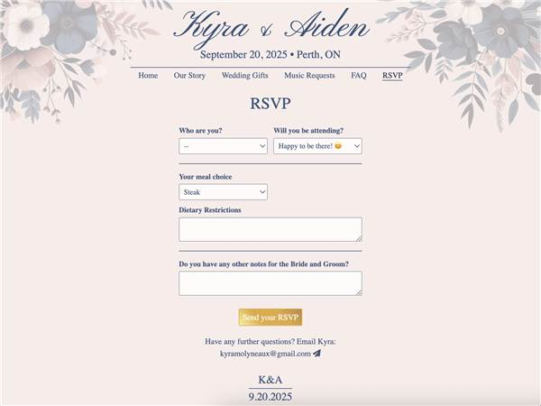

# Kyra & Aiden's Wedding Site

The website our guests used for our wedding: our story, FAQs, places to stay, gifts, RSVPs and song requests. Kyra and I built it in 2024 and tested it on family of every age.



## Stack

- React and SCSS, built with Vite and webpack (`app/`)
- Two AWS Lambda functions (`app/aws/`) that take RSVPs and song requests and email them to us through Amazon SES

The guest list in `app/src/pages/attendees.js` uses placeholder names.

## Running it

```bash
cd app
npm install
npm run dev
```
